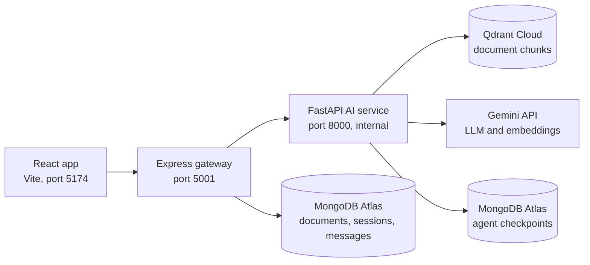
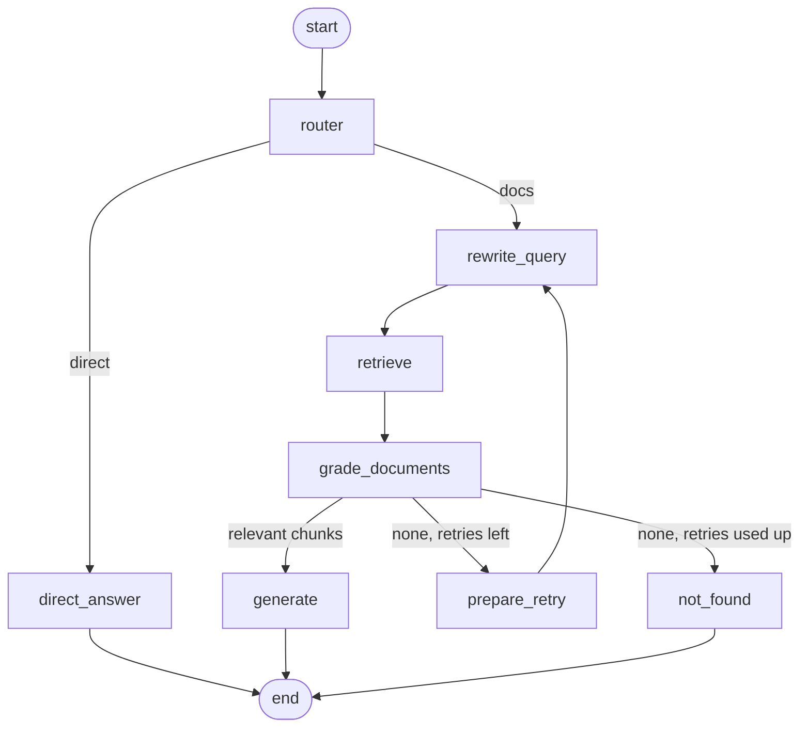

# DocChat

An adaptive RAG assistant for engineering documentation. Upload developer docs (PDF, Markdown, text) and ask questions.
A LangGraph agent answers **only from your documents, with citations** (file name and page), or honestly says it could not find the answer.

## The problem

Engineers lose time searching scattered docs, and a plain chatbot invents answers. DocChat routes each question,
rewrites it into a good search query, retrieves chunks, **grades** them against the user's original question, retries with
new wording if nothing relevant came back, and only then answers. Every answer shows where it came from.

## Architecture



React talks only to Express. Express talks only to FastAPI (and to MongoDB for its own records). Only FastAPI talks to Qdrant,
Gemini and the checkpoints, so API keys never leave the AI service.

## The LangGraph agent



- **router**: Gemini with structured output picks `docs` or `direct`; when unsure it picks `docs`. It also resets per-turn state.
- **rewrite_query**: builds one standalone search query from the original question and the last 6 messages. Wording only, never meaning.
- **retrieve**: top-k similarity search in Qdrant (cosine, HNSW).
- **grade_documents**: one batched LLM call keeps only chunks that really answer the user's original question.
- **prepare_retry**: records the failed query and adds 1 to the retry counter; the next rewrite must not repeat it.
- **generate** / **not_found** / **direct_answer**: final nodes; each appends one message to the history.
- **Query drift rules**: every rewrite starts from the original question, the rewrite changes words only, and grading and answering
  always use the original question, never the rewritten query.
- **Memory**: a `MongoDBSaver` checkpointer keyed by `thread_id` (the chat's id). Prompts see only the last 6 messages.

## Tech stack

| Layer | Technology |
|---|---|
| Frontend | React (Vite), plain CSS |
| Gateway | Node.js, Express 5, Multer, Axios, Mongoose |
| AI service | Python 3.12, FastAPI, LangChain, LangGraph |
| LLM | Gemini (model from `GEMINI_MODEL`) via `langchain-google-genai` |
| Embeddings | Gemini `gemini-embedding-001`, shortened to 768 dimensions |
| Vector DB | Qdrant (cloud or Docker), cosine distance |
| Database | MongoDB (Atlas or Docker): app records and LangGraph checkpoints |

## Setup

You need Node 20+, Python 3.12, a Gemini API key, a MongoDB (Atlas free tier, or `docker compose up -d`) and a Qdrant
(Qdrant Cloud free tier, or the same `docker compose`).

1. **AI service**
   ```bash
   cd ai-service
   python3.12 -m venv .venv && source .venv/bin/activate
   pip install -r requirements.txt
   ```
   Create `ai-service/.env` (see `.env.example` in the project root):
   `GEMINI_API_KEY`, `GEMINI_MODEL`, `EMBED_MODEL=gemini-embedding-001`, `MONGO_URI`, `MONGO_DB=docchat`,
   `QDRANT_URL`, `QDRANT_API_KEY` (empty for local Docker), `QDRANT_COLLECTION=docchat_docs`.
   ```bash
   uvicorn app.main:app --port 8000
   ```
2. **Express gateway**
   ```bash
   cd server && npm install
   ```
   Create `server/.env`: `PORT=5001`, `AI_SERVICE_URL=http://localhost:8000`, `MONGO_URI`, `MONGO_DB=docchat`, `CLIENT_URL=http://localhost:5174`.
   ```bash
   node index.js
   ```
3. **React app**
   ```bash
   cd client && npm install && npm run dev
   ```
   Open http://localhost:5174. Optional: `client/.env` with `VITE_API_URL=http://localhost:5001/api`.

Secrets live only in `.env` files, which are git-ignored.

## API

React to Express (port 5001):

| Method | Path | Purpose |
|---|---|---|
| POST | `/api/upload` | Upload a `.pdf`, `.md` or `.txt` (up to 10 MB); returns `{docId, filename, chunks}` |
| GET | `/api/documents` | List uploaded documents |
| POST | `/api/sessions` | Create a chat; returns `{sessionId}` |
| GET | `/api/sessions` | List chats, newest first |
| GET | `/api/sessions/:id/messages` | Saved messages of a chat, oldest first |
| POST | `/api/chat` | `{sessionId, question}` returns `{answer, sources, route, retries, title}` |

Express to FastAPI (internal): `GET /health`, `POST /ingest` (multipart `file`, `doc_id`), `POST /chat` (`{thread_id, question}`).
Errors are short JSON messages: 400 bad input, 404 unknown chat, 503 when the AI service is down.

## Evaluation

<!--RESULTS-->

## Known limitations

- No login: everyone shares all documents and chats.
- No document delete or per-document filter; re-uploading a file duplicates its chunks.
- A question can take up to 7 Gemini calls (about 5 to 30 seconds).
- The grader can misjudge, and history is trimmed to the last 6 messages.
- The evaluation uses one small document, so its conclusions are tentative.

## Future work

Agent trace UI with streaming, Mem0 long-term memory, Neo4j graph memory, Valkey caching, authentication, cloud deployment,
per-document filtering, AI-written chat titles.
